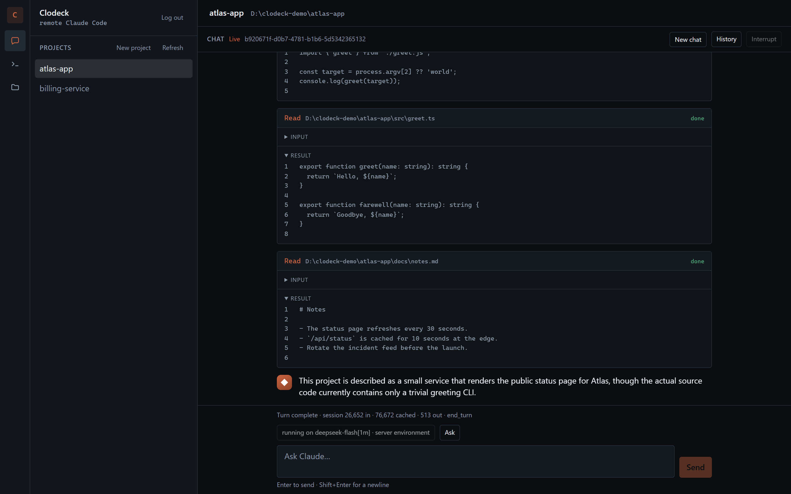
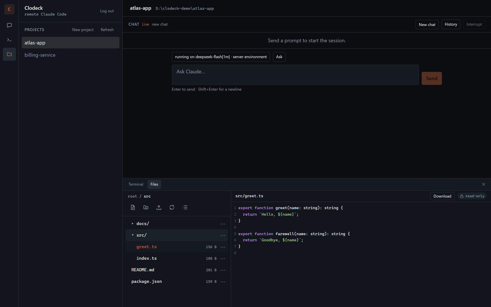

# Clodeck

[](https://github.com/clodeck/clodeck/actions/workflows/ci.yml)
[](LICENSE)
[](https://nodejs.org)

**A self-hosted web UI for the [Claude Agent SDK](https://docs.claude.com/en/api/agent-sdk/overview):
your Claude Code sessions, a real shell and a file browser — from any browser, on any device.**

Clodeck runs on the machine that holds your project folders. Every immediate child directory of one
root is a project, and a project gives you three things in one place: a streaming agent session, a
terminal whose working directory is that folder, and a file drawer scoped to it. One user, one
password, no database — the directories *are* the registry.



## Contents

- [Features](#features)
- [Quickstart](#quickstart)
- [How it works](#how-it-works)
- [Deployment](#deployment)
- [Configuration](#configuration)
- [Security](#security)
- [Development](#development)
- [Documentation](#documentation)
- [License](#license)

## Features

| | |
|---|---|
| **Projects** | One row per directory under `PROJECTS_ROOT`. Create a project from the sidebar or delete one for real — recursively, behind a typed-name confirmation, and refused while a turn or terminal is live. |
| **Chat** | One Claude Agent SDK session per project: streamed turns, tool cards, an approval modal, and session history with resume. |
| **Terminal** | A real shell in the project directory — `node-pty` streamed as raw bytes into xterm.js. |
| **Files** | A tree that expands in place: markdown preview, a code view with line numbers and syntax colouring, edit and save, create, rename, delete, upload, download, and drag-to-move. Every path is re-validated against the project root. |
| **Auth** | A single password, an `HttpOnly` session cookie, a per-address login lockout, and every API route and WebSocket behind it. |
| **Provider profiles** | A *session* picks the endpoint and model it runs on — a cheap model for grunt work, a strong one for design, in the same project. Credentials never leave the server's environment. |
| **Permission modes** | A *session* picks what the agent may do without asking: **Ask**, **Accept edits**, **Plan** or **Bypass** — with a stricter contract than the SDK's own names, and a project's deny rules always on top. A Bash prompt can be answered **“Always allow Bash”** for the session. |
| **Command menu** | `/` in the composer lists the session's own slash commands, filtered as you type. |

The terminal and the files share **one summonable drawer** below the chat; the chat keeps the stage.



## Quickstart

**Requirements:** Node ≥ 22.12, a directory to hold your projects, and — for the chat answer only —
an Anthropic API key. Login, the terminal, the file drawer and history work without one, and
`npm run dev:fake` replaces the model with a scripted fake for offline UI work.

```sh
git clone https://github.com/clodeck/clodeck.git
cd clodeck
npm install                      # installs shared, server and web; wires the pre-commit hook

mkdir -p ~/clodeck-projects/hello
UI_PASSWORD=dev PROJECTS_ROOT=~/clodeck-projects npm run dev
```

Open <http://localhost:5173>, sign in with `dev`, and select `hello`. Then edit files, open the
terminal, and start a chat.

- The client (Vite, port 5173) proxies `/api` and `/ws` to the server (port 3001), so the browser only
  ever talks to one origin. `PORT=3300 npm run dev` moves both halves together.
- `UI_PASSWORD` is required: without it the server boots **fail-closed** and no login can succeed.
- `npm run dev` reads no file. If your values live in `.env` — written by `bash scripts/setup-clodeck.sh`
  — use `npm run dev:env` instead.
- On Linux, `npm install` compiles `node-pty` and needs `python3 make g++`.

To run the built app — one process, no dev server, which is what you deploy:

```sh
UI_PASSWORD=dev PROJECTS_ROOT=~/clodeck-projects npm run serve   # http://127.0.0.1:3001
```

Full walkthroughs, including a Linux server, Windows, Docker and HTTPS: [Deployment](docs/deployment.md).

## How it works

There is no database and no registry: **the folders in your projects root are the projects**. The
product is two moving parts, and in production they collapse into one.

```text
development:   browser ──> :5173 Vite ──proxy──> :3001 server ──> projects root
production:    browser ──────────────> :3001 server ──> projects root   (serves the built client)
```

| Package | What it owns |
|---|---|
| [`shared/`](shared) | `@clodeck/shared` — domain types (`Project`, `Principal`) and the transport contracts shared by both sides. |
| [`server/`](server) | `@clodeck/server` — Node/Fastify: project discovery over the filesystem, the Agent SDK behind a provider facade, the session bus at `/ws`, the terminal at `/ws/terminal`, scoped file access, and the auth gate over all of it. |
| [`web/`](web) | `@clodeck/web` — React + Vite + Tailwind: login, project switcher, streaming chat, xterm.js terminal and file drawer. |

A request path, end to end: the client calls same-origin `/api/...` → the auth gate reads the session
cookie and attaches a principal or answers `401` → the route handler. WebSocket upgrades take the same
gate, plus an `Origin` check, before a socket exists.

## Deployment

Clodeck is meant to run on a dedicated machine — the one holding the projects — and be reached from
wherever you are. Pick the row that matches you; each is a full walkthrough.

| Your situation | Route |
|---|---|
| A server with a domain | [Docker Compose with Caddy and Let's Encrypt](docs/deployment.md#docker-compose-with-a-domain) — real HTTPS, nothing to install on clients |
| A server, no domain, and you want encryption | [SSH tunnel](docs/deployment.md#the-ssh-tunnel), or [Caddy's internal certificate](docs/deployment.md#caddys-internal-certificate) |
| A server, no domain, just you | [The direct route](docs/deployment.md#the-direct-route) — plain `http://<ip>:<port>`, and the traffic is **cleartext** |
| A Linux box | [Linux server](docs/deployment.md#linux-server) — systemd unit included |
| A Windows box | [Windows server](docs/deployment.md#windows-server) |
| Docker, no domain | [Docker](docs/deployment.md#docker) — loopback and a tunnel |

Publishing is automated: `main` is integration, `master` is production, and a merge commit into
`master` verifies and deploys from a self-hosted runner on the server itself. See
[CI/CD](docs/ci-cd.md).

## Configuration

Everything is read by the server from its environment (or `clodeck.config.json` in its working
directory). The full table is in [Configuration](docs/configuration.md); these are the ones that
change how a deployment behaves:

| Variable | Default | Meaning |
|---|---|---|
| `PROJECTS_ROOT` | — | The directory whose immediate child directories are the projects. |
| `UI_PASSWORD` / `UI_PASSWORD_FILE` | — | The single account's password. Unset → fail-closed. |
| `PORT` / `HOST` | `3001` / `127.0.0.1` | Bind address. Loopback unless you deliberately expose it. |
| `CLODECK_PUBLIC_URL` | — | The origin a browser reaches the app at. Its scheme decides the session cookie's `Secure` flag. |
| `CLODECK_TRUSTED_PROXIES` | — | Proxies whose `X-Forwarded-For` is believed — what the login lockout keys on. |
| `CLODECK_PERMISSION_MODE` | `default` | The mode a session starts in: `default`, `acceptEdits`, `plan` or `bypassPermissions`. |
| `ANTHROPIC_API_KEY` | — | The provider credential, read by the Agent SDK. Never stored by Clodeck. |

## Security

One account, reachable from the internet, so the boundaries are enforced rather than documented:

- **The login** is a salted **scrypt** hash built at boot; the plaintext is never kept. Sessions live
  server-side, so a logout or restart invalidates them, and five failures from one address lock it out
  for fifteen minutes.
- **The projects root is the whole world.** Every path is re-validated by `realpath` containment, so a
  symlink cannot lead out of it. Writes never follow a symlink in the target's final segment and never
  overwrite on create, upload or move.
- **The terminal is a real shell** with the server's privileges. Run Clodeck as a dedicated
  unprivileged user, or use the Docker image, which already runs as `node`.
- **The agent's reach is the session's permission mode**, enforced on the server and on the wire — not
  by hiding a button — and a project's own deny/ask rules apply in every mode, Bypass included.
- **Credentials stay in the server's environment**: never stored, never persisted, never invented, and
  never sent to the browser.

The reasoning behind the cookie, the provider and the permission rules lives in [`docs/adr/`](docs/adr).

## Development

| Command | What it does |
|---|---|
| `npm run dev` | Server (`tsx watch`) and Vite client together. |
| `npm run dev:fake` | The same, on a scripted fake Agent SDK — no key, no network. |
| `npm test` | The Vitest suite across all packages. |
| `npm run typecheck` | Type-checks everything, writes nothing. |
| `npm run build` | Builds `shared` → `server` → `web` into each `dist/`. |
| `npm run serve` | Preflight, build, and serve the built client — the deployment command. |
| `npm run e2e` | Playwright against an app that is already running. |

The pre-commit hook runs the type check, the suite and the tracker's consistency check, so a red tree
is never committed. `shared` must be built before `server` and `web` can import it — every command
above does that for you. Conventions, traps worth knowing and the end-to-end setup are in
[Development](docs/development.md).

## Documentation

| Document | Contents |
|---|---|
| [Deployment](docs/deployment.md) | Every way to run it: Linux, Windows, Docker, Compose + Caddy, tunnels, and why an undeclared origin bounces a login. |
| [Configuration](docs/configuration.md) | Every environment variable, provider profiles, and the permission-mode contract. |
| [Security](docs/security.md) | The auth model, the cookie rule, and exactly what the app can touch. |
| [Troubleshooting](docs/troubleshooting.md) | Symptom-first answers to the failures people actually hit. |
| [Development](docs/development.md) | The dev loop, the test layers, and the traps that are load-bearing. |
| [CI/CD](docs/ci-cd.md) | The branch model, the checks, and the deploy runbook. |
| [`docs/adr/`](docs/adr) | Architecture decision records. |
| [`docs/fa/`](docs/fa) | A Persian-language walkthrough (Finglish). |
| [`AGENTS.md`](AGENTS.md) | Working conventions for this repository. |

## Contributing

Issues and pull requests are welcome. Work happens on a short-lived branch and lands on `main` by
merge; `master` is production and moves only by a pull request from `main`. Run `npm install` once so
the pre-commit hook is wired, and read [`AGENTS.md`](AGENTS.md) before a large change.

## License

[MIT](LICENSE).
